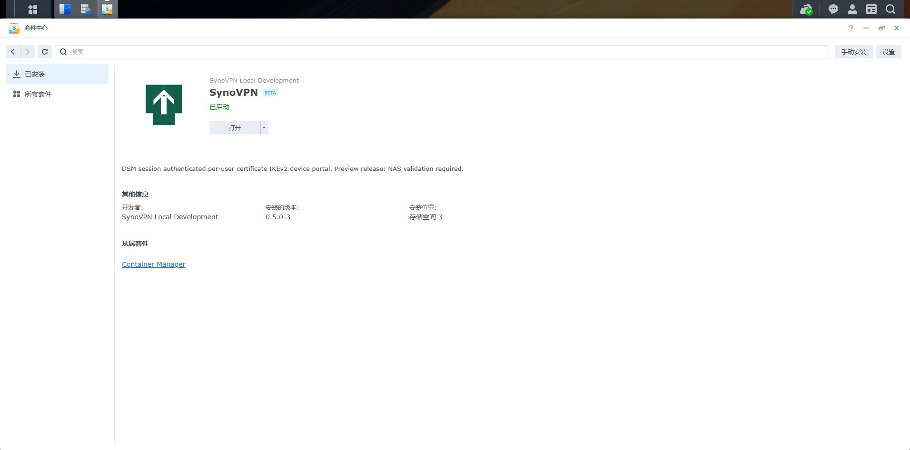

# 0.5.0-3 NAS 升级核验

2026-11-06，SA6400 / DSM 7.4.1-90080 Update 1 更新成功。套件中心显示 0.5.0-3、已启动、安装于原存储空间 3；门户显示原 DSM 用户、管理员入口、两台未解绑设备及网关服务已就绪。VPN 网关仍为 nas.hnzyy.ltd，允许网段仍为 192.168.10.0/24。本次未签发、下载或撤销设备凭据，未变更路由器端口。

二维码根据可信 CGI 的当前 HTTPS 来源生成；从 https://192.168.10.10:5001 登录并打开套件后重新生成，手机需在可访问 NAS 的内网。公开 VPN 地址保持原域名，外部 VPN 仅需 UDP 500/4500。NAS HTTPS 证书需被领取设备信任。

验证：go test ./internal/web 与 go vet ./... 通过。新增回归测试覆盖 iOS/Android 内网领取 URL、绑定领取来源、拒绝错误来源且不消耗令牌、VPN 域名不变。本次远程通过公网 DSM 验证部署和就绪，未实际完成内网手机扫码领取。

SPK SHA-256：bee584e913ba099f94fa8a3bd9e17016e8d468474280ba02782cc8846f48befb。

