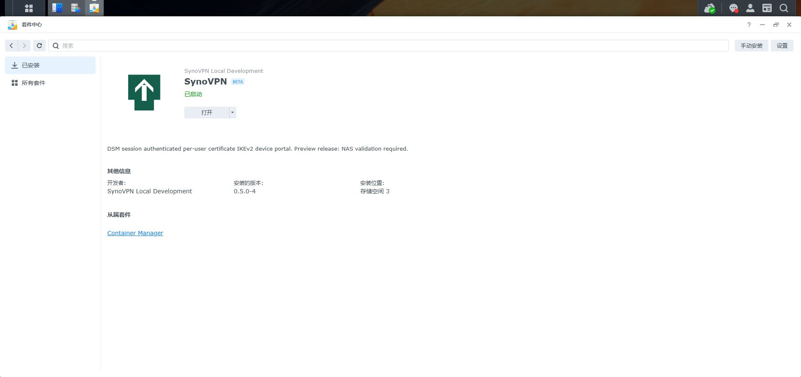

# 0.5.0-4 Android 下载兼容更新

2026-11-06，用户报告 iQOO 11 扫码可打开领取页，点击后下载任务没有数据。现有代码是一次性原生 POST 附件，推测与 Android 独立下载器重发 GET 或独立连接有关；未取得该手机浏览器网络记录，不能确认唯一根因。

本版 Android 领取改为页面 fetch POST 收齐 ZIP、显式点击本地 Blob 保存；iOS 原生表单保留。增加响应长度、错误显示、45 秒接收超时和 5 分钟/离页本地临时副本清理。令牌来源绑定、单次消费和私钥授权规则不变。

go test ./...、go vet ./...、node tools/test-phone-download.cjs 均通过。JS 模拟测试覆盖单次 POST/本地保存/重复点击/清理/错误/iOS 表单，不代替真机浏览器测试。

NAS 套件中心已显示 0.5.0-4、已启动、原存储空间 3；门户用户和管理员入口正常，原两台有效设备保留，网关已就绪。没有创建、领取、下载或撤销生产设备凭据。需用户重新生成二维码，使用 iQOO 11 验证文件保存。

SPK SHA-256：0f9e2a04ae09cbe49b2bfe1243ec83c48348ec72a8f3e5a6e6daaf1e8d4e669a。

