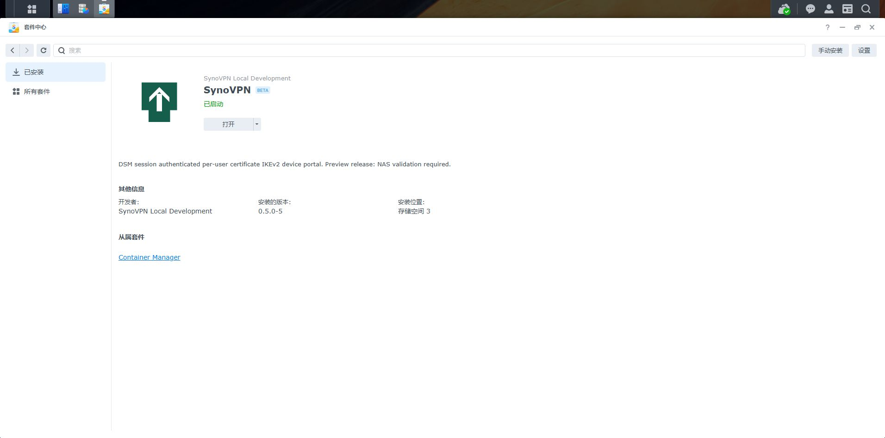
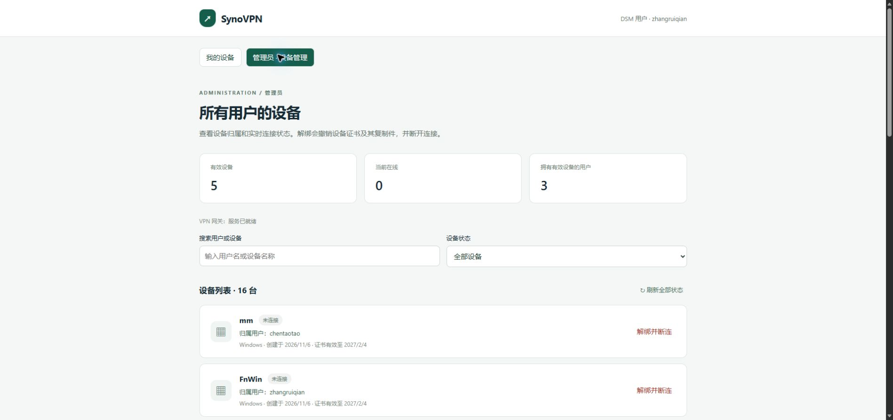

# 0.5.0-5 删除已解绑设备记录

2026-11-06，SA6400 / DSM 7.4.1-90080 Update 1 成功更新。套件中心显示 0.5.0-5、已启动、存储空间 3。门户网关已就绪，管理员列表读取 16 条记录、5 台有效设备、3 位有效设备归属用户，个人有效设备 3 台。

个人和管理员列表已解绑条目均出现“删除记录”；打开个人记录确认弹窗、点击“保留记录”取消成功。没有删除生产记录，没有签发、下载或撤销设备凭据。

验证：go test ./...、go vet ./...、node tools/test-phone-download.cjs 通过。新增集成测试覆盖所有权、管理员权限、CSRF、活动/撤销中拒绝清理、归档后双列表消失、审计归属保留及 SQLite 重新打开后归档持久性。

删除为列表归档，不物理清除 devices/audit 或引擎撤销账本。新增 device_archive 表，旧设备、证书和状态保留。

SPK SHA-256：ae19c48985ce2d4bd113f4a739327ed7b47e6fb03015f0c5c530205b68a4d6f1。

