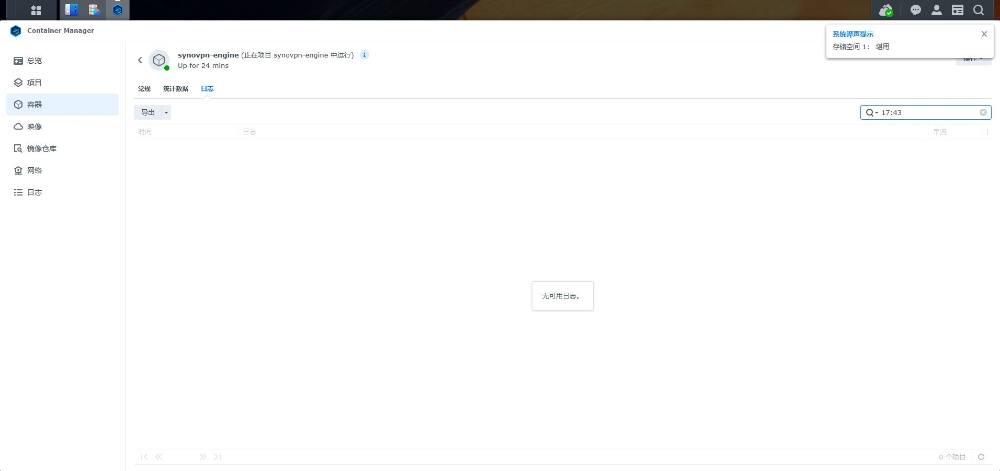

# Win10 错误 87 排查

2026-11-06 17:43:10.625–17:43:11.010（+08:00），用户提交 Win10 22H2 / Build 19045 报告。测试连接实际为 SynoVPN-SDrW…；RAS 返回 87，DNS A 为 112.53.120.90。机器证书存在私钥，EKU 包含 clientAuth 和 IPsec IKE Intermediate。IKE AES256/SHA256/DH14、ESP AES256/SHA256128/PFS None 与服务端配置有交集。

通过 DSM Container Manager 的 synovpn-engine 日志核对，17:43 收到来自 192.168.10.30:500 的 Windows IKE_SA_INIT，选择 AES_CBC_256/HMAC_SHA2_256_128/PRF_HMAC_SHA2_256/MODP_2048，向客户端发送 IKE_SA_INIT 响应。随后只有 keepalive、半开 SA 超时删除，没有对应客户端 IKE_AUTH。身份未发送，按时间关联此次拨号，但不能用已认证身份做强关联。不是已证实的端口封锁或算法不匹配，尚不能区分客户端证书/密钥访问与适配器/协议栈故障。

提供 repair-ikev2.cmd + ps1，只允许 Win10 2004+ 桌面系统、检测到无已连接 VPN 且唯一 MS_AGILEVPNMINIPORT 时调用 pnputil /restart-device。不会卸载驱动、重置 TCP/IP/Winsock、导入证书、修改 VPN 参数或自动重启计算机。仅作可控的恢复尝试，不标记根因已确认/已修复。脚本 AST 语法检查通过；未在用户故障 Win10 运行。NAS 配置未更改。

## 17:57 复测

用户提交 SynoVPN-diagnostics-20261106-175722.txt：同一 SDrW… 连接，17:57:22.092–17:57:22.235（+08:00），仍为 RAS 87。DNS、算法和证书元数据不变。没有恢复脚本日志，不能确认前一步适配器重启是否成功。尚未定位唯一根因；没有升级 NAS 或修改已验证可用的 Win11 配置。

新增 trace-auth.cmd（dist/SynoVPN-Windows-auth-trace.zip）：UAC 自提权、仅一条连接时自动选择、管理员身份 RSA SHA256/PKCS1 本地签名与验证（不导出密钥/签名）、密钥提供程序信息；临时启用可用的 CAPI2/IKEEXT/RasClient Operational 日志，拨号一次并采集该时间窗事件，最后恢复原日志开关。事件输出限制条数与单条长度。管理员签名成功不等于 IKEEXT 服务身份能够访问私钥；缺少某一日志不等于不存在故障。语法检查通过，尚未在故障 Win10 执行。不实施证书/算法/网络重置，不自动重启系统。
